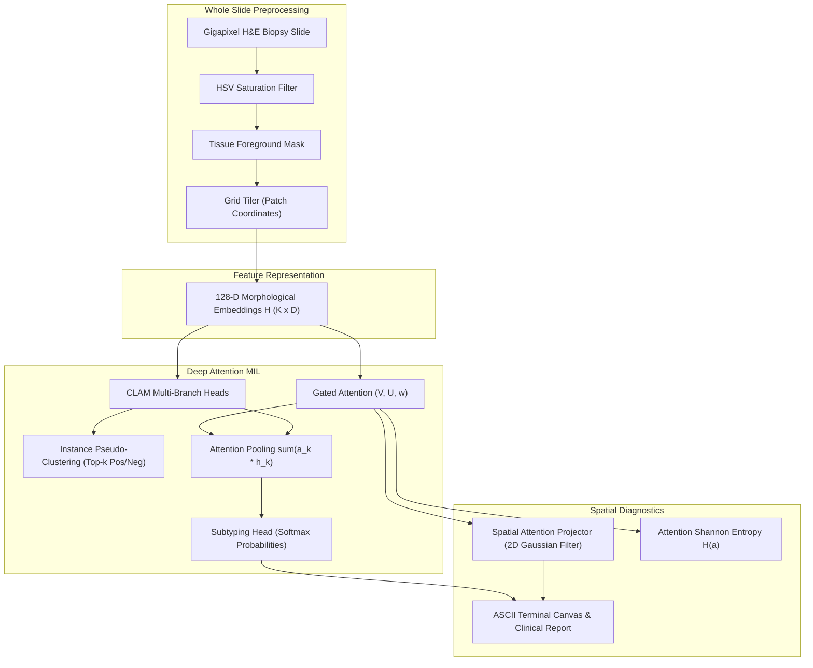

# PathoAttn

[](https://github.com/ZengLLQ/patho-attn/actions/workflows/ci.yml)
[](https://www.python.org/)
[](https://opensource.org/licenses/MIT)

**PathoAttn** is a scientific digital pathology Python library for gigapixel Whole Slide Image (WSI) processing, Deep Attention Multiple Instance Learning (ABMIL), Clustering-Constrained Attention MIL (CLAM), cancer subtyping (e.g., Invasive Ductal vs Invasive Lobular Carcinoma, LUAD vs LUSC), and spatial tumor attention heatmap reconstruction.

---

## Key Features

- **Gigapixel WSI Tissue Segmentation**: Color space transformation (RGB to HSV saturation channel) and Otsu morphological filtering to isolate tissue specimens from bright glass slides.
- **Grid Tiling & Tissue Filtering**: Non-overlapping and strided patch coordinate generation filtered by foreground tissue area fraction.
- **Gated Attention MIL (ABMIL)**: Deep attention mechanism (Ilse et al., ICML 2018) with non-linear hyperbolic tangent and sigmoid gating for instance aggregation.
- **Clustering-Constrained MIL (CLAM)**: Multi-branch attention networks (Lu et al., *Nature Biomedical Engineering* 2021) with top-$k$ positive and negative instance pseudo-clustering supervision.
- **Spatial Heatmap Reconstruction**: 2D coordinate backprojection with 2D Gaussian density smoothing to generate continuous cancer risk heatmaps and identify invasive tumor nests.
- **Attention Shannon Entropy Diagnostics**: Mathematical entropy $\mathcal{H}_{\text{norm}}$ quantification distinguishing focal micro-metastatic lesions from diffuse tumor infiltration.
- **Clinical Cohort Metrics**: Multi-class and binary ROC-AUC (Mann-Whitney U statistic), sensitivity, specificity, balanced accuracy, and confusion matrix evaluation.
- **Terminal ASCII Visualizations**: Built-in ASCII spatial heatmap renderer, attention distribution bar charts, and confusion matrix tables.

---

## Mathematical & Clinical Foundations

### 1. The Gigapixel Digital Pathology Challenge
A typical diagnostic biopsy slide scanned at 20x or 40x magnification contains between $10^9$ and $10^{10}$ pixels (e.g., $100,000 \times 100,000$). Slides cannot fit into GPU memory as a single image. Under the Multiple Instance Learning (MIL) formulation:
- Each slide is a **bag** $X = \{ \mathbf{x}_1, \dots, \mathbf{x}_K \}$ of $K$ patches (instances).
- Only a single slide-level clinical diagnosis $Y \in \{0, \dots, M-1\}$ is known (e.g. cancer subtype), without patch-level ground-truth annotations.

### 2. Gated Attention Mechanism (ABMIL)
Given patch feature embeddings $\mathbf{h}_k \in \mathbb{R}^D$, Ilse et al. introduced the gated attention formulation:

$$a_k = \frac{\exp\left( \mathbf{w}^T (\tanh(\mathbf{V} \mathbf{h}_k^T) \odot \sigma(\mathbf{U} \mathbf{h}_k^T)) \right)}{\sum_{j=1}^K \exp\left( \mathbf{w}^T (\tanh(\mathbf{V} \mathbf{h}_j^T) \odot \sigma(\mathbf{U} \mathbf{h}_j^T)) \right)}$$

where $\mathbf{V} \in \mathbb{R}^{L \times D}$, $\mathbf{U} \in \mathbb{R}^{L \times D}$, $\mathbf{w} \in \mathbb{R}^{1 \times L}$, $\odot$ is the Hadamard element-wise product, and $\sigma(\cdot)$ is the logistic sigmoid function.

The aggregated slide-level representation $\mathbf{z}_{\text{slide}}$ is:

$$\mathbf{z}_{\text{slide}} = \sum_{k=1}^K a_k \mathbf{h}_k$$

The slide-level classification logits are:

$$\hat{\mathbf{y}} = \text{softmax}(\mathbf{W}_c \mathbf{z}_{\text{slide}} + \mathbf{b}_c)$$

```
        Instances H (K x D)
           │
      ┌────┴────┐
    V H       U H
      │         │
    tanh      sigmoid
      └────┬────┘
        Hadamard (x)
           │
           w
           │
        Softmax ──> Attention Weights a_k (sum to 1.0)
           │
        Weighted Sum ──> Slide Embedding z_slide
           │
       Classifier ──> Diagnostic Call (IDC / ILC / Benign)
```

### 3. Clustering-Constrained Attention MIL (CLAM)
In CLAM (Lu et al., 2021), each of the $M$ cancer classes has its own dedicated attention branch $c \in \{0, \dots, M-1\}$.
For a slide with ground-truth class $y$:
- **Top-$k$ positive instances** ($I_{\text{pos}}$): Patches with the highest attention in branch $y$.
- **Top-$k$ negative instances** ($I_{\text{neg}}$): Patches with the lowest attention in branch $y$ (benign stroma / normal tissue).

An auxiliary instance classifier $g(\mathbf{h})$ is trained on these pseudo-labeled instances:

$$\mathcal{L}_{\text{total}} = c_1 \mathcal{L}_{\text{slide}} + c_2 \mathcal{L}_{\text{instance}}$$

$$\mathcal{L}_{\text{instance}} = \frac{1}{2k} \left[ \sum_{i \in I_{\text{pos}}} \ell_{\text{CE}}(g(\mathbf{h}_i), y) + \sum_{j \in I_{\text{neg}}} \ell_{\text{CE}}(g(\mathbf{h}_j), \text{background}) \right]$$

This prevents the attention network from collapsing onto spurious histological artifacts or slide borders.

### 4. Attention Shannon Entropy
The degree of spatial localization is quantified by Shannon entropy:

$$\mathcal{H}(\mathbf{a}) = -\sum_{k=1}^K a_k \ln(a_k), \qquad \mathcal{H}_{\text{norm}} = \frac{\mathcal{H}(\mathbf{a})}{\ln(K)}$$

- $\mathcal{H}_{\text{norm}} \ll 0.70$: **Focal lesion** (isolated tumor nest, lymphovascular invasion).
- $\mathcal{H}_{\text{norm}} \approx 1.00$: **Diffuse infiltration** or broad stroma involvement.

---

## Architecture



---

## Installation

```bash
git clone https://github.com/ZengLLQ/patho-attn.git
cd patho-attn
pip install -e .
```

To run development tests:
```bash
pip install pytest
pytest -v
```

---

## Command-Line Interface (CLI)

PathoAttn provides the command-line utility `patho-attn`:

### 1. Simulated Digital Pathology Demonstration
```bash
patho-attn demo --subtype 1
```
Output:
```
========================================================================
PathoAttn :: Gigapixel Digital Pathology Deep Attention MIL & Subtyping
========================================================================
[1/4] Simulating H&E Biopsy Slide (True Diagnosis: Invasive Ductal (IDC))...
[2/4] Segmenting Tissue Foreground & Tiling into Patch Bag...
      Extracted 74 tissue patches from whole slide coordinate grid.
[3/4] Performing CLAM Multi-Branch Deep Attention Inference...
------------------------------------------------------------------------
Predicted Diagnosis:  Invasive Ductal (IDC) (Confidence: 86.4%)
Class Probabilities:
  [0] Benign / Normal           :   4.2%
  [1] Invasive Ductal (IDC)     :  86.4%
  [2] Invasive Lobular (ILC)    :   9.4%

Attention Diagnostics:
  Normalized Shannon Entropy: 0.985 (Focal lesion: False)
  Effective Driving Patches:  70.2 of 74
  Top-5 Patch Attention Mass: 11.8%

[4/4] Projecting Spatial Diagnostic Attention Heatmap...
  +----- Whole Slide Attention Heatmap ------+
  |                                          |
  |             .::...::..:----:::           |
  |        .::::--==----===---=++*+::.       |
  |        :-==----===---=++*+===+++=::...   |
  |     ...:=+++---====--=++*+===++*+==-==:  |
  |   ..:::-===---*@%%*==-==+====***+--:::.  |
  |  .--====+++=--=+**+===++*+===++**==---:  |
  |   ::---:---:::::---:::----:::::----:--:  |
  |                                          |
  +------------------------------------------+
  Scale: [Low]   . : - = + * # % @   [High Malignancy Risk]
========================================================================
```

### 2. Cohort Classification Performance Evaluation
```bash
patho-attn eval --n-slides 50
```

---

## Python API Usage

```python
import numpy as np
from patho_attn import (
    WSITiler,
    GatedAttentionMIL,
    CLAMModel,
    SpatialAttentionProjector,
    ClinicalEvaluator,
    PathoVisualizer,
)

# 1. Segment tissue and extract patch coordinate bag
tissue_mask = WSITiler.segment_tissue(rgb_slide, saturation_threshold=0.12)
patch_coords = WSITiler.tile_slide(
    slide_dimensions=(1000, 1000),
    tissue_mask=tissue_mask,
    patch_size=64,
    min_tissue_fraction=0.30,
)

# 2. Extract deep features H of shape (K, 128)
# features = feature_extractor(patch_coords)

# 3. Predict slide diagnosis using Gated Attention MIL
abmil = GatedAttentionMIL(input_dim=128, hidden_dim=64, num_classes=2)
pred = abmil.forward(features)
print(f"Predicted Class: {pred.predicted_class}, Confidence: {pred.probabilities[pred.predicted_class]*100:.1f}%")

# 4. Analyze attention entropy
diag = ClinicalEvaluator.analyze_attention(pred.attention_weights)
print(f"Normalized Entropy: {diag.normalized_entropy:.3f}, Focal Tumor Nest: {diag.is_focal_lesion}")

# 5. Reconstruct continuous 2D spatial tumor attention heatmap
heatmap = SpatialAttentionProjector.generate_heatmap(
    coordinates=patch_coords,
    attention_weights=pred.attention_weights,
    slide_dimensions=(1000, 1000),
    grid_shape=(40, 40),
)

# 6. Render in ASCII terminal canvas
print(PathoVisualizer.render_spatial_heatmap(heatmap))
```

---

## Verification & Testing

PathoAttn runs automated CI tests on Linux, macOS, and Windows across Python 3.11 and 3.12:

```bash
pytest -v
```

All 15 tests verify RGB-HSV color transformations, tissue segmentation masks, ABMIL attention normalization, CLAM multi-branch instance clustering losses, spatial coordinate reprojection, and Mann-Whitney ROC-AUC cohort calculations.

---

## License

MIT License. See [LICENSE](LICENSE) for details.
